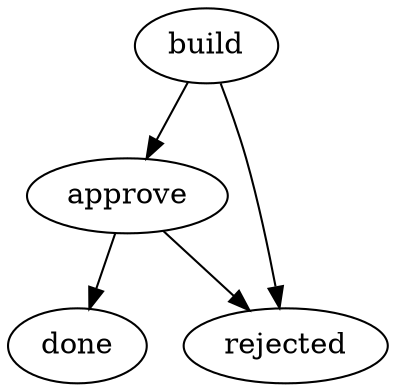

# Spore Workflow Language (SWL)

**A portable, implementation-independent specification for describing and running workflows.**

SWL defines how workflow graphs, action interfaces, execution, and durable state interact without requiring a particular engine, programming language, database, or transport. It is stewarded by **WebTree → Runspore → Spore Workflow Language**. [Runspore](https://github.com/Web-tree/runspore) is an implementation of related concepts; conformance is measured against the published specification, not against a private implementation.

> **Status: public working draft.** This repository is the independent specification source. No stable conformance claim or runtime compatibility is implied until the conformance suite is implemented and passed. Legacy Runspore dialect identifiers are intentionally not part of the SWL specification.

## Read the specification

| Part | Defines | Useful for |
| --- | --- | --- |
| [Definition Model](spec/definition.md) | Workflow graph, nodes, action **interfaces**, bindings and capabilities | Editors, compilers, domain DSLs |
| [SWL-DOT](spec/notation.md) | DOT-based human authoring representation | Graph editors, parsers |
| [Execution Semantics](spec/execution.md) | Routing, state transitions, loops, errors, retries | Runtimes, simulators |
| [Invocation and Control](spec/invocation.md) | Sync/deferred work, events, signals, cancellation | Hosts, workers |
| [Durability and State](spec/state.md) | Persistence guarantees, store provider, inspection/export | Durable hosts, inspectors |
| [Distribution](spec/distribution.md) | Packages, referenced assets and identity | Build tools, registries |
| [Conformance](spec/conformance.md) | Feature profiles, interoperability tests and claims | Implementers |
| [Research](research/prior-art.md) | Attractor, SCXML, Open Workflow, ASL, CWL, Nexus, Temporal | Contributors |

The parts are separately implementable **with declared dependencies**. A graph editor need not implement an engine. A workflow can run on Temporal or another host without using Runspore; implementers must reject unsupported required semantics rather than silently downgrade.

## Quick example

Human-readable **SWL-DOT** graph:

The graph defines topology and outcome routing. Node and action contracts live in the normalized [Definition Model](spec/definition.md), not in Graphviz styling attributes. This is a **draft SWL example**, not a claim that the current Runspore parser accepts it unchanged.

## Design principles

- **Interface before implementation:** An action contract is separate from how a command, worker, service, or Temporal Activity fulfills it.
- **One semantic source:** Normalized definitions and normative rules take precedence over any one parser or implementation.
- **Explicit portability:** Implementations advertise supported parts, features, limits, and bindings.
- **Deterministic decisions:** A pure transition may authorize work but never performs external effects itself.
- **Honest durability:** At-least-once delivery and uncertain external outcomes are explicit; exactly-once external effects are not assumed.
- **Presentation is not behavior:** Graphviz shapes, labels and colors do not change execution.

## Relationship to Runspore

SWL owns the standard, schemas, examples and tests. Runspore owns its runtime, CLI, storage adapter and implementation documentation. [Runspore's website](https://runspore.com/docs) is intended to show a pinned copy of this same specification, not a second editable source.

## Contributing

See [governance](GOVERNANCE.md). The specification uses precise **MUST**, **SHOULD**, and **MAY** wording where settled; open design points are explicitly labeled **Draft decision**. Avoid inventing standard identifiers or promising conformance while the contracts are still being validated.

Licensed under [MIT](LICENSE).
