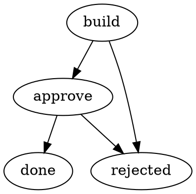

# Spore Workflow Language (SWL)

**A portable, implementation-independent specification for describing and running workflows.**

SWL defines how workflow graphs, action interfaces, execution, and durable state interact without requiring a particular engine, programming language, database, or transport. It is stewarded by **WebTree → Runspore → Spore Workflow Language**. [Runspore](https://github.com/Web-tree/runspore) is an implementation of related concepts; conformance is measured against the published specification, not against a private implementation.

> **Status: public working draft.** This repository is the independent specification source. No stable conformance claim or runtime compatibility is implied until the conformance suite is implemented and passed. Legacy Runspore dialect identifiers are intentionally not part of the SWL specification.

## Choose your documentation

| What you want to do | Start here |
| --- | --- |
| Install Runspore, create a workflow, run it and inspect its progress | [Runspore user documentation](https://runspore.com/docs) |
| Understand the portable language or build an independent implementation | [SWL specification](spec/README.md) |
| Read the standard within the Runspore documentation | [SWL reference chapter](https://runspore.com/docs/swl), a pinned snapshot of this repository |
| Explore the draft semantics in code and run the fixtures | [TypeScript/Bun implementation](implementations/typescript/README.md) |

Runspore's guides describe its supported commands, workflow format and runtime behavior. The SWL specification describes the independent language contract; its examples and feature profiles do not establish support in a particular Runspore release.

## Read the specification

| Part | Defines | Useful for |
| --- | --- | --- |
| [Definition Model](spec/definition.md) | Workflow graph, nodes, action **interfaces**, bindings and capabilities | Editors, compilers, domain DSLs |
| [SWL-DOT](spec/notation.md) | DOT-based human authoring representation | Graph editors, parsers |
| [Execution Semantics](spec/execution.md) | Routing, state transitions, loops, errors, retries | Runtimes, simulators |
| [The `parallel` profile](spec/parallel.md) | Splits, gathers, optional arrivals, failure across branches | Runtimes, validators |
| [Invocation and Control](spec/invocation.md) | Sync/deferred work, events, signals, cancellation | Hosts, workers |
| [Durability and State](spec/state.md) | Persistence guarantees, store provider, inspection/export | Durable hosts, inspectors |
| [Distribution](spec/distribution.md) | Packages, referenced assets and identity | Build tools, registries |
| [Conformance](spec/conformance.md) | Feature profiles, interoperability tests and claims | Implementers |
| [Fixtures](spec/fixtures.md) | The test files every implementation checks itself against | Implementers |
| [Research](research/prior-art.md) | Attractor, SCXML, Open Workflow, ASL, CWL, Nexus, Temporal | Contributors |

The parts are separately implementable **with declared dependencies**. A graph editor need not implement an engine. A workflow can run on Temporal or another host without using Runspore; implementers must reject unsupported required semantics rather than silently downgrade.

## Quick example

Human-readable **SWL-DOT** graph:

The graph defines topology and outcome routing. Node and action contracts live in the normalized [Definition Model](spec/definition.md), not in Graphviz styling attributes. This is a **draft SWL example**, not a claim that the current Runspore parser accepts it unchanged.

## Design principles

- **Interface before implementation:** An action contract is separate from how a command, worker, service, or Temporal Activity fulfills it.
- **One semantic source:** Normalized definitions and normative rules take precedence over any one parser or implementation.
- **Explicit portability:** Implementations advertise supported parts, features, limits, and bindings.
- **Deterministic decisions:** A pure transition may authorize work but never performs external effects itself.
- **Honest durability:** At-least-once delivery and uncertain external outcomes are explicit; exactly-once external effects are not assumed.
- **Presentation is not behavior:** Graphviz shapes, labels and colors do not change execution.

## Relationship to Runspore

SWL owns the standard, schemas, examples and conformance fixtures. Runspore owns its runtime, CLI, storage adapter and [user documentation](https://runspore.com/docs), including installation, workflow authoring, execution and troubleshooting.

The [SWL chapter](https://runspore.com/docs/swl) is one reference section within that user documentation. It displays a pinned revision of this repository and links back here for edits. The hosted snapshot may lag this repository's `main` branch; use its displayed revision when comparing behavior or reporting an issue. Propose language changes here so the website and other consumers can update from the same source.

The [TypeScript/Bun implementation](implementations/typescript/README.md) is a library for exploring and testing draft SWL semantics. Its fixture results describe that implementation and revision; they do not establish Runspore conformance or durable-host guarantees.

## Contributing

See [governance](GOVERNANCE.md). The specification uses precise **MUST**, **SHOULD**, and **MAY** wording where settled; open design points are explicitly labeled **Draft decision**. Avoid inventing standard identifiers or promising conformance while the contracts are still being validated.

Licensed under [MIT](LICENSE).
